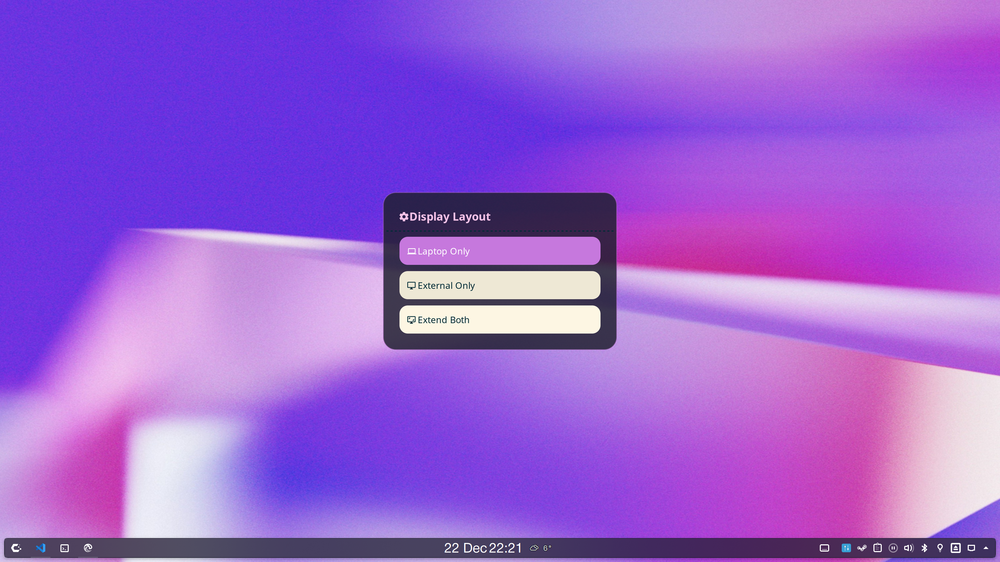
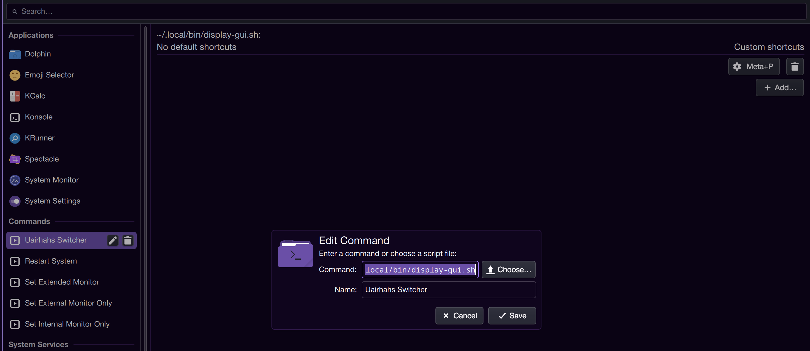

# Bifocal

Switch a docked laptop between its own screen, the dock monitor, or both,
on KDE Plasma.

A bifocal lens stacks two zones: distance on top, close-up below. Bifocal's
extended layout does the same, with the external monitor centred above the
laptop panel. Its other two layouts use one zone at a time.

It targets a niche setup (a laptop with a single external monitor) and is
mainly kept for personal use. It is not affiliated with KDE.



## Layouts

| Layout     | Result                                        |
| ---------- | --------------------------------------------- |
| `internal` | Laptop panel only                             |
| `external` | External monitor only                         |
| `extended` | Both, with the external monitor centred above |

## Dependencies

- KDE Plasma 5 or later, with `kscreen-doctor` (libkscreen)
- `wofi` for the picker (`rofi` is used as a fallback)
- `notify-send`
- GeistMono Nerd Font, or any Nerd Font (set `FONT` in `bifocal-menu`)

## Installation

```bash
git clone https://github.com/uairhahs/bifocal.git
cp bifocal/bifocal bifocal/bifocal-menu ~/.local/bin/
```

Keep both scripts in the same directory: `bifocal-menu` calls the
`bifocal` next to it.

## Usage

```bash
bifocal-menu       # open the picker
bifocal            # cycle: internal, then extended, then external
bifocal internal   # laptop panel only
bifocal external   # external monitor only
bifocal extended   # both, external above
```

## Keyboard shortcut

In System Settings, open Keyboard, then Shortcuts, and add a new command
shortcut that runs `~/.local/bin/bifocal-menu` (or `bifocal` to cycle
without a picker). Then assign it a key.



## Configuration

Each layout is applied with `kscreen-doctor`. The scale defaults, used when
the current scale cannot be read, are near the top of `bifocal`; adjust them
and the output detection to suit your hardware.

## License

See [COPYING.txt](COPYING.txt).

## Contributing

Pull requests are welcome. For major changes, please open an issue first to
discuss what you would like to change.
