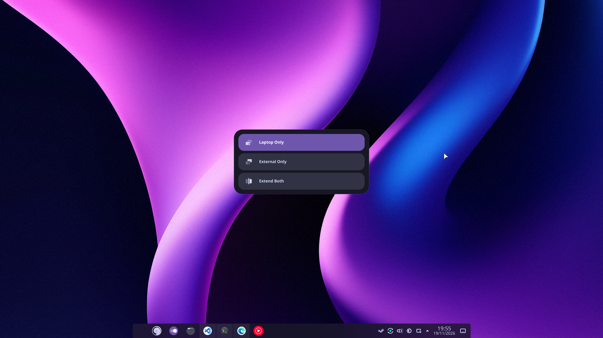
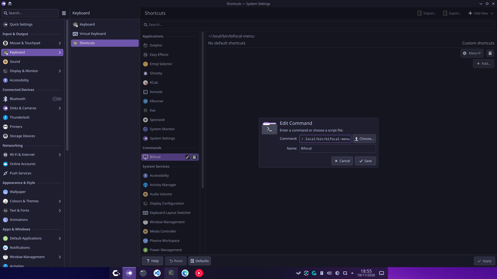

# Bifocal

<p align="center">
  
</p>

<p align="center">
  <a href="COPYING.txt"></a>
  
  
  </p>

Switch a docked laptop between its own screen, the dock monitor, or both,
on KDE Plasma.

A bifocal lens stacks two zones: distance on top, close-up below. Bifocal's
extended layout does the same, with the external monitor centred above the
laptop panel. Its other two layouts use one zone at a time.

It targets a niche setup (a laptop with a single external monitor) and is
mainly kept for personal use. It is not affiliated with KDE.



## Layouts

| Layout     | Result                                        |
| ---------- | --------------------------------------------- |
| `internal` | Laptop panel only                             |
| `external` | External monitor only                         |
| `extended` | Both, with the external monitor centred above |

## Dependencies

- KDE Plasma 6, with `kscreen-doctor` (libkscreen)
- For the picker: Qt 6's `qml` tool (`qml6`, from Qt Declarative),
  `layer-shell-qt` and Kirigami, all of which Plasma 6 already ships
- `flock` (util-linux)
- `notify-send`

The picker keeps its own shape but takes its colours from your colour scheme,
its font from your system font, and its icons from your icon theme (the same
icons as KDE's display switcher).

## Installation

```bash
git clone https://github.com/uairhahs/bifocal.git
cd bifocal
./install.sh
```

This copies `bifocal`, `bifocal-menu` and `bifocal-menu.qml` to
`~/.local/bin` (or `$XDG_BIN_HOME`), adds a "Bifocal" command for the
keyboard shortcut, warns about missing dependencies, and tells you if the
install directory is not on your `PATH`. Run it again after pulling to
update.

The command runs `~/.local/bin/bifocal-menu` rather than a fixed path, so it
keeps working if your home directory moves. Only an install outside your home
directory (for example `--dir /usr/local/bin`) uses the full path.

| Option        | Effect                             |
| ------------- | ---------------------------------- |
| `--dir DIR`   | Install to `DIR` instead           |
| `--uninstall` | Remove the scripts and the command |

The three files must stay in the same directory: `bifocal-menu` runs the
`bifocal` and `bifocal-menu.qml` next to it.

## Usage

```bash
bifocal-menu       # open the picker; run again while open to move down a row
bifocal            # cycle: internal, then extended, then external
bifocal internal   # laptop panel only
bifocal external   # external monitor only
bifocal extended   # both, external above
```

## Keyboard shortcut

In System Settings, open Keyboard, then Shortcuts. `install.sh` has already
added "Bifocal" under Commands, running `~/.local/bin/bifocal-menu`; select
it, choose Add and press a key (`Meta+P` below).

With the picker open, pressing the shortcut again moves the highlight down a
row (wrapping back to the top). Once you stop, the highlighted layout is
applied: when you release Meta, or a second after the last press. The arrow
keys, Tab and `j`/`k` move the highlight without applying anything; press
Enter or click a layout to apply it. Escape or clicking elsewhere closes the
picker.

Without the installer, choose Add New, then Command, enter
`~/.local/bin/bifocal-menu` and name it Bifocal. To cycle layouts without the
picker, use `~/.local/bin/bifocal` as the command instead.



## Configuration

Each layout is applied with `kscreen-doctor`. The scale defaults, used when
the current scale cannot be read, are near the top of `bifocal`; adjust them
and the output detection to suit your hardware.

## License

See [COPYING.txt](COPYING.txt).

## Contributing

Pull requests are welcome. For major changes, please open an issue first to
discuss what you would like to change.
